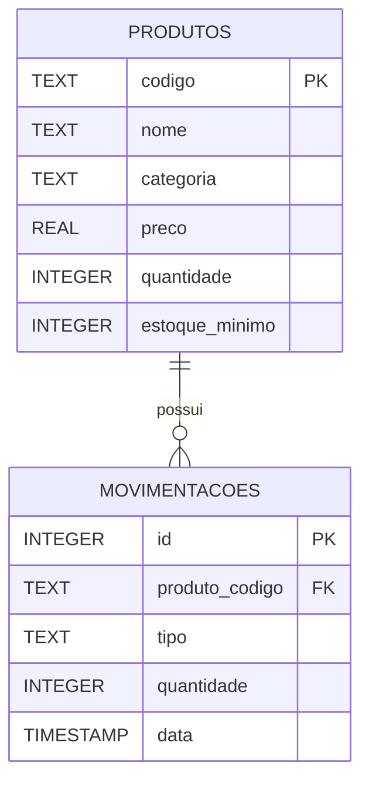

# Sistema de Controle de Estoque

Aplicativo desktop em Python para cadastrar produtos, controlar compras e saídas, consultar o saldo atual e emitir relatórios. A interface usa Tkinter e os dados ficam em um banco SQLite local.

## Requisitos

- Python 3.10 ou superior
- Tkinter (incluído na maioria das instalações do Python; em algumas distribuições Linux é necessário instalar o pacote `python3-tk`)

Não são necessárias dependências Python externas.

## Como executar

Na pasta do projeto, execute:

```bash
python3 main.py
```

Também é possível iniciar pelo arquivo solicitado para o trabalho:

```bash
python3 codigo05.py
```

O banco `estoque.db` é criado automaticamente na primeira execução, usando o esquema de `banco.sql`. O arquivo do banco é local e está ignorado pelo Git.

## Funcionalidades

- Cadastro, edição e exclusão de produtos com código único, nome, categoria, preço e estoque mínimo.
- Registro de entradas e saídas com data e quantidade; a saída é recusada quando não há saldo suficiente.
- Consulta do estoque com filtro por categoria e busca por código ou nome.
- Identificação visual dos produtos no limite ou abaixo do estoque mínimo.
- Histórico das movimentações.
- Relatório visual do valor em estoque por categoria e indicadores de quantidade, valor total e itens com estoque baixo.
- Exportação da posição filtrada do estoque para CSV, compatível com planilhas.
- Validações na interface e restrições no próprio SQLite.

## Estrutura do banco de dados



`movimentacoes.produto_codigo` referencia `produtos.codigo`. O gatilho `atualizar_estoque_movimentacao` altera o saldo automaticamente após cada movimentação. O gatilho `validar_saida_estoque` impede registrar saídas acima do saldo disponível. As tabelas, índices, chaves estrangeiras e gatilhos estão definidos em [`banco.sql`](./banco.sql).

## Organização do código

```text
codigo05.py             Ponto de entrada solicitado
main.py                 Ponto de entrada alternativo
estoque_gui.py          Interface gráfica e navegação
estoque/
  banco.py              Operações SQLite, produtos e movimentações
  exportacao.py         Exportação CSV
  validacoes.py         Validações compartilhadas
banco.sql               Criação do esquema, índices e gatilhos
tests/
  test_banco.py         Testes automatizados do banco e do estoque
```

## Testes

Execute os testes automatizados com:

```bash
python3 -m unittest discover -v
```

## Histórico do GitHub

O histórico de commits é mantido no próprio repositório. Para atender ao requisito acadêmico de pelo menos oito commits, registre as etapas reais do desenvolvimento em commits separados e publique a branch no repositório público. Não crie commits artificiais apenas para atingir uma contagem.
